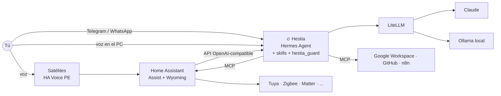

<div align="center">

# 🔥 Hestia

**Tu asistente personal tipo JARVIS, open source: controla tu casa, escucha y habla en español e inglés, gestiona tu agenda, tu correo y tus proyectos, y aprende habilidades nuevas.**

*Hermes es el mensajero que sale al mundo; Hestia guarda el hogar.*
Hestia está construida sobre [Hermes Agent](https://github.com/NousResearch/hermes-agent) y [Home Assistant](https://www.home-assistant.io/).

[](https://github.com/DrewGGM/hestia/actions/workflows/ci.yml)


</div>

---

## ¿Qué hace?

| | |
|---|---|
| 🏠 **Casa** | Luces, enchufes, clima, persianas, escenas y rutinas con *cualquier* marca: Tuya, Xiaomi, Zigbee, Matter, Alexa/Google… a través de Home Assistant |
| 🎙️ **Voz** | Satélites por habitación ("Hey Jarvis" / "Okay Nabu", y pronto "Hey Hestia"), voz en el PC y notas de voz por Telegram/WhatsApp. Bilingüe ES/EN |
| 📅 **Agenda y correo** | Briefing diario, captura rápida de tareas y recordatorios, triage de Gmail y borradores |
| 💼 **Negocios y código** | Estado de repos, builds, sitios y workflows de n8n. Resumen semanal |
| 🎓 **Universidad** | Entregas, notas necesarias y plan de estudio |
| 💰 **Finanzas** | Registro de gastos, vencimientos y resumen mensual |
| 🧠 **Automejora** | Memoria persistente y skills que escribe ella misma, **con tu aprobación** |
| 🛡️ **Seguridad** | Confirmación humana para acciones físicas sensibles y protección contra la inyección de prompts desde correos o webs |

## Cómo está hecha

Hestia **reutiliza** proyectos maduros en lugar de reinventarlos. Su código propio es configuración, skills y un plugin de seguridad.



| Capa | Proyecto | Por qué |
|---|---|---|
| Agente | **Hermes Agent** (Nous Research, MIT) | Memoria, skills autogeneradas, más de 21 gateways, voz, cron, MCP y plugins. Unas 252k ★ |
| Casa | **Home Assistant** | Más de 3.000 integraciones, MCP Server nativo y pipeline de voz |
| Modelos | **LiteLLM** + Claude + Ollama | Híbrido: lo privado y rápido en local, lo complejo en la nube |
| Voz | **Wyoming** (Parakeet/Whisper, Piper, openWakeWord) + microWakeWord | Local, con español nativo |

¿Por qué estas piezas y no OpenClaw, Letta o un agente desde cero? Lee la **[investigación completa](docs/00-investigacion.md)**, con fuentes verificadas.

## Inicio rápido

### Opción A: servidor con Docker (recomendado para 24/7)

```bash
git clone https://github.com/DrewGGM/hestia.git && cd hestia
cp .env.example .env          # llena ANTHROPIC_API_KEY, LITELLM_MASTER_KEY, HESTIA_API_KEY, TELEGRAM_*
docker compose up -d          # cerebro (Hermes + LiteLLM)
./scripts/doctor.sh           # verifica que todo esté bien
```

Escríbele a tu bot de Telegram: *"Hola Hestia, ¿quién eres?"* 👋

Añade capacidades con profiles:
```bash
docker compose --profile local --profile voice up -d                               # + modelo local + voz
docker compose -f docker-compose.yml -f compose.gpu.yaml --profile local up -d     # con GPU NVIDIA
```

### Opción B: nativo en tu PC (voz con micrófono)

```bash
# 1. Instala Hermes Agent
curl -fsSL https://hermes-agent.nousresearch.com/install.sh | bash          # Linux/macOS/WSL
# iex (irm https://hermes-agent.nousresearch.com/install.ps1)              # Windows PowerShell

# 2. Instala Hestia como perfil
hermes profile install github.com/DrewGGM/hestia --alias

# 3. Habla con ella
hestia chat        # luego /voice on (Ctrl+B) o /wake on ("Hey Hermes")
```

📖 Guía completa: **[docs/02-instalacion.md](docs/02-instalacion.md)**: Windows, VPS + Tailscale y Cloudflare Tunnel.

## Documentación

| Guía | Contenido |
|---|---|
| [00 · Investigación](docs/00-investigacion.md) | Comparativa de frameworks, voz, domótica y seguridad, con fuentes |
| [01 · Arquitectura](docs/01-arquitectura.md) | Capas, flujos y topologías de despliegue |
| [02 · Instalación](docs/02-instalacion.md) | Docker, nativo, Windows y VPS |
| [03 · Configuración](docs/03-configuracion.md) | Modelos, `USER.md`, integraciones por fase y cron |
| [04 · Voz](docs/04-voz.md) | Satélites, pipelines bilingües y voz en el PC |
| [05 · Domótica](docs/05-domotica.md) | Home Assistant paso a paso y qué comprar |
| [06 · Seguridad](docs/06-seguridad.md) | Modelo de amenazas y checklist ⚠️ **léela** |
| [07 · Skills y plugins](docs/07-skills-y-plugins.md) | Cómo enseñarle cosas nuevas |
| [08 · Roadmap](docs/08-roadmap.md) | Fases del proyecto |
| [ADRs](docs/adr/) | Decisiones de diseño |

## Skills incluidas

| Categoría | Skill | Ejemplo |
|---|---|---|
| Hogar | `control-casa` | "Apaga las luces de la sala" |
| Hogar | `escenas-y-rutinas` | "Me voy a dormir" · "Cada noche a las 11 apaga el calentador" |
| Productividad | `briefing-diario` | "Buenos días, ¿qué tengo hoy?" (también por cron a las 7:00) |
| Productividad | `captura-rapida` | "Recuérdame mañana a las 3 llamar al banco" |
| Productividad | `gestion-correo` | "¿Algo importante en el correo?" |
| Universidad | `universidad` | "¿Cuánto necesito en el final para pasar?" |
| Finanzas | `finanzas-personales` | "Gasté 45 mil en mercado" |
| Negocios | `estado-negocios` | "¿Cómo van los proyectos?" |
| Sistema | `automejora` | "Aprende a…" · revisión semanal de memoria y skills |

## Seguridad en 30 segundos

Un asistente que lee tu correo **y** abre tu puerta es un objetivo. Esto es lo que hace Hestia:
- 🔒 **Cerraduras y alarma nunca se exponen al agente.** Solo funcionan con scripts que te piden confirmación en el celular.
- 🧪 **El contenido externo contamina la sesión.** Después de leer un correo o una web, *cualquier* acción física pide aprobación (`hestia_guard`).
- ✋ **Lo irreversible pide aprobación:** enviar correos, comandos peligrosos, escrituras en GitHub y n8n, skills nuevas.
- 🌐 **Nada se expone a Internet:** todo escucha en `127.0.0.1`, y el acceso remoto va por Tailscale o Cloudflare Access.
- 📜 **Auditoría:** cada acción física queda registrada en `logs/hestia_audit.jsonl`.

## Estado

🚧 **Fase 1 en curso.** Ya están la investigación, la arquitectura, la distribución de Hermes, las skills, el plugin de seguridad (probado y validado por `hermes plugins validate`) y el stack Docker. Siguen la casa y la voz (fase 2). Ver el [roadmap](docs/08-roadmap.md).

## Desarrollo

```bash
pip install pytest pyyaml
pytest -q                  # pruebas del guardián + validación de skills, YAML y compose
```

## Créditos

Hestia se apoya en el trabajo de [Nous Research](https://github.com/NousResearch/hermes-agent), [Open Home Foundation / Home Assistant](https://www.home-assistant.io/), [Wyoming / Rhasspy](https://github.com/OHF-Voice), [LiteLLM](https://github.com/BerriAI/litellm), [Ollama](https://ollama.com) y la comunidad de [agentskills.io](https://agentskills.io).

Licencia [MIT](LICENSE).
